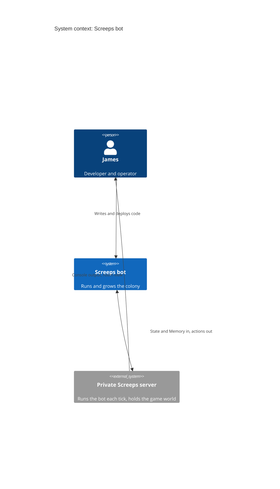
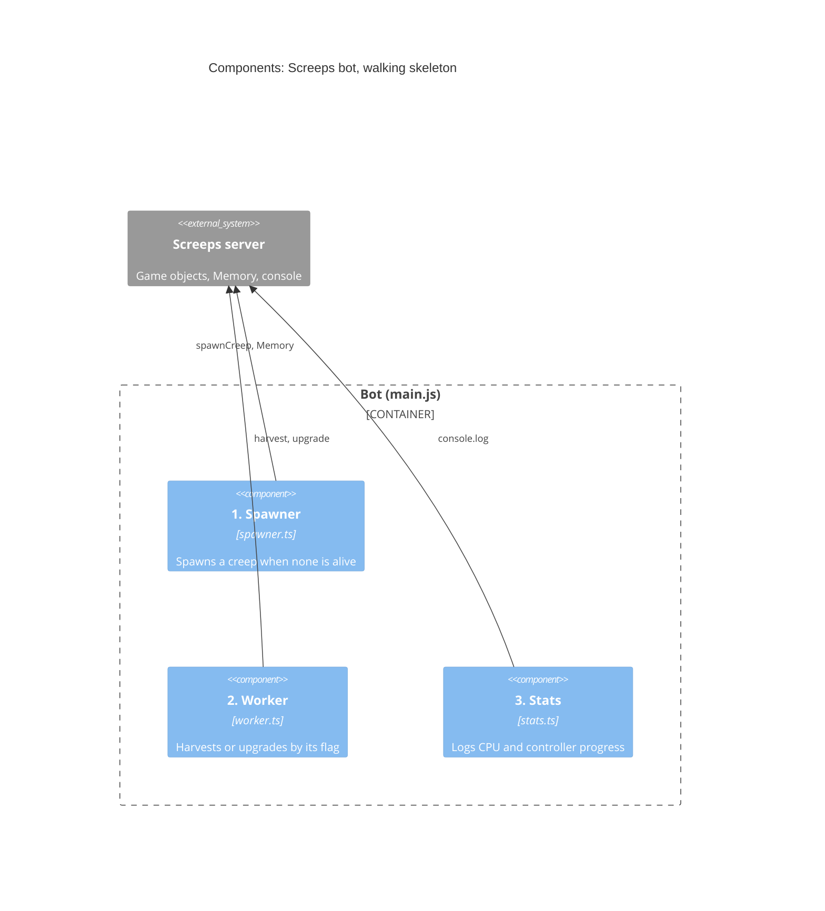
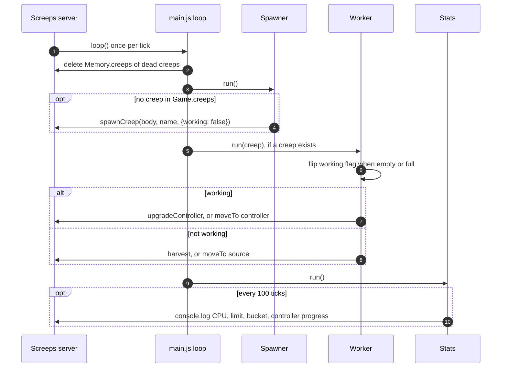
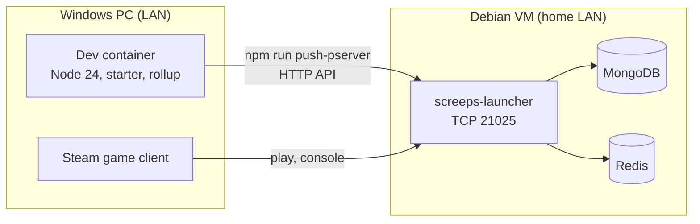

# Screeps bot: architecture

This document follows the [arc42](https://arc42.org) template. Sections 1 to 4 describe the whole bot and change rarely. Sections 5, 6, 9 and 11 are updated with each slice. Sections 8, 10 and 12 are filled in as they become real.

Status: system pass complete (sections 1 to 4, 2026-11-24). Walking-skeleton slice in progress: sections 5 and 6 reviewed 2026-11-25.

## 1. Introduction and goals

### Problem statement

> I need a bot that grows my Global Control Level without me watching it, within the CPU limit. It must survive NPC invader attacks and keep expanding to new rooms over weeks of unattended play.

### 1.1 Requirements overview

The bot must:

| ID | Capability |
|----|------------|
| R1 | Run the economy in every room it owns: harvest, spawn, build and upgrade. |
| R2 | Expand: pick, claim and bootstrap a new room whenever GCL allows. |
| R3 | Defend owned rooms against NPC invaders, and clear invader cores that block expansion. |
| R4 | Recover on its own after losing creeps, structures or its in-memory state. |
| R5 | Report the numbers needed to see whether it is improving (GCL growth, CPU, per-room figures). |

**Later.** A good bot should eventually play the complete game. These are part of that, but are deliberately not handled now. The design should not make them hard to add (see quality goal Q2).

| Item | Why later |
|------|-----------|
| Defend against human players | No human players on the server yet. Most likely next addition. |
| Market trading | Player-to-player; nobody to trade with on a solo server. |
| Power processing | Late game (needs RCL 8 and a power spawn); raises GPL, not GCL. |
| Source Keepers and strongholds | Optional growth, mostly for fun. |
| Attacking human players | No human players on the server yet. |

### 1.2 Quality goals

In priority order. When two goals conflict, the higher one wins.

| # | Goal | Meaning |
|---|------|---------|
| Q1 | Autonomy | Recovers without help from anything short of losing every room. |
| Q2 | Modifiability | New behaviours (the "later" items above) can be added without rewriting what exists. |
| Q3 | Observability | GCL growth, CPU use and per-room numbers are visible. CPU is logged from day one. |
| Q4 | CPU discipline | Stays within the CPU limit. No CPU tuning until it becomes a measured problem. |

### 1.3 Stakeholders

| Who | Expectation |
|-----|-------------|
| James (developer and operator) | A bot he can leave running for weeks, and a codebase he can learn from and extend in spare time. |

## 2. Constraints

| Constraint | Effect on the design |
|------------|----------------------|
| Private server, default CPU limit and tick speed | The real limit is logged (`Game.cpu.limit`) rather than assumed. |
| Tick-based runtime: the game calls our code once per tick | All behaviour is driven from one main loop. |
| Only `Memory` reliably survives between ticks; global state can reset at any time | Anything that must persist lives in `Memory`; anything in global scope is a rebuildable cache. |
| One developer working in spare time | Favour simple, readable code and small slices over cleverness. |

## 3. Context and scope

| Neighbour | What crosses the boundary |
|-----------|---------------------------|
| James | Source code in (via a deploy step, chosen in an ADR); console output and the game view out. |
| Private server | Each tick: game state and `Memory` in, actions and `Memory` writes out. NPC invaders are part of the game world the server simulates. |

**Scope.** The bot's code, its build and its deploy step are inside the system. The server, the game rules and NPC behaviour are outside it.

**Later.** An external stats dashboard (for example Grafana, fed from the bot's `Memory`) will join this diagram when the console stops being enough. Until then, observability (Q3) is met through console output.

## 4. Solution strategy

Decisions are made at the last responsible moment: now only if the walking skeleton forces them or they would be expensive to change later.

| Topic | Decision | Status |
|-------|----------|--------|
| Language | TypeScript ([ADR-0001](adr/0001-use-typescript.md)) | Accepted 2026-11-24 |
| Build and deploy | Bundle to one `main.js` with the screeps-typescript-starter, upload through the server API from a dev container ([ADR-0002](adr/0002-bundle-and-upload-via-server-api.md)) | Accepted 2026-11-25 |
| Where the server runs | screeps-launcher + MongoDB + Redis in Docker on a Proxmox VM, LAN only ([ADR-0003](adr/0003-run-server-with-screeps-launcher-in-docker.md)) | Accepted 2026-11-25 |
| State | `Memory` is the source of truth. Anything held in global scope is a cache that can be rebuilt from `Memory` and game state after a global reset. | Follows from the constraints in section 2 and quality goal Q1 |
| Overall structure (roles, manager hierarchy, process scheduler, ...) | Deferred | Decide in the first slice with more than one creep, when there is real code to judge it against. Q2 (modifiability) is the main criterion. |

## 5. Building block view

_Slice 1 (walking skeleton), reviewed 2026-11-25._

The bot is one bundle, `main.js`, which the server runs once per tick. For this slice it has three plain modules, called in order by the loop in `main.ts`. This is deliberately not the overall structure (roles, managers or a scheduler), which section 4 defers to the first multi-creep slice.

| Component | Responsibility | Serves | State it uses |
|-----------|----------------|--------|---------------|
| `main.ts` (loop) | First deletes `Memory.creeps` entries for creeps that no longer exist (housekeeping for all of `Memory`, as the starter already does). Then calls Spawner, Worker and Stats in that order, inside the starter's error mapper so one failure is logged instead of stopping the tick. | F5, Q1 | `Game.creeps`, `Memory.creeps` |
| Spawner | If `Game.creeps` is empty, spawns one creep with body `[WORK, CARRY, MOVE, MOVE]` (250 energy; one MOVE per other part keeps it at full speed on plain ground even when full, and it fits the 300 energy a new spawn holds) and memory `{ working: false }`. A creep still being spawned is already in `Game.creeps`, so this never makes a second one. | F1, F3 | `Game.creeps` |
| Worker | Flips `working` to true when the creep is full and to false when it is empty. When working, upgrades the controller (moving to it if out of range); otherwise harvests the closest active source (moving to it if out of range). | F2 | `creep.memory.working` |
| Stats | Every 100 ticks (a starting value, kept as one constant and judged in the retrospective), logs CPU used, `Game.cpu.limit`, the bucket, and controller level and progress. | F4, Q3 | None |

Nothing is kept in global scope, so a global reset loses nothing (F6). Decisions behind the Spawner and Worker are in the slice doc, "Design it twice".

## 6. Runtime view

_Slice 1 (walking skeleton), reviewed 2026-11-25._

### One tick

### Scenarios

| Scenario | What happens |
|----------|--------------|
| First deploy, no creep | Tick 1: Spawner finds `Game.creeps` empty and starts spawning. The creep appears a few ticks later with `working: false` and goes to harvest. |
| Creep dies of old age | Next tick: the loop deletes its memory, and the Spawner, finding no creep, spawns a replacement. Upgrading pauses for the spawn time plus the walk to the source (known cost, slice doc decision 2). |
| Spawn lacks energy | `spawnCreep` returns an error and nothing happens; the Spawner tries again next tick. The spawn refills on its own. |
| Global reset | The loop runs from a fresh global scope. Everything it reads (`Game`, `Memory`, the creep's `working` flag) is still there, so the creep carries on mid-trip (F6). |

## 7. Deployment view

Setup steps: the "Screeps Dedicated Server Setup" doc. Decision: [ADR-0003](adr/0003-run-server-with-screeps-launcher-in-docker.md).

## 9. Architecture decisions

See [docs/adr/](adr/).

| ADR | Title | Status |
|-----|-------|--------|
| [0001](adr/0001-use-typescript.md) | Write the bot in TypeScript | Accepted |
| [0002](adr/0002-bundle-and-upload-via-server-api.md) | Bundle with a build tool and upload through the server API | Accepted |
| [0003](adr/0003-run-server-with-screeps-launcher-in-docker.md) | Run the private server with screeps-launcher in Docker on a Proxmox VM | Accepted |

## 11. Risks and technical debt

| Risk | Mitigation |
|------|------------|
| `screepsmod-auth` pinned to 2.8.3 because 2.9/2.10 crash with `screepsmod-mongo` | Check upstream before upgrading mods; remove the pin when fixed |
| Starter toolchain is old (TypeScript 4.8, Rollup 2, upload plugin from 2022) | Builds fine on Node 24 today; upgrade dependencies gradually and commit a lockfile |
